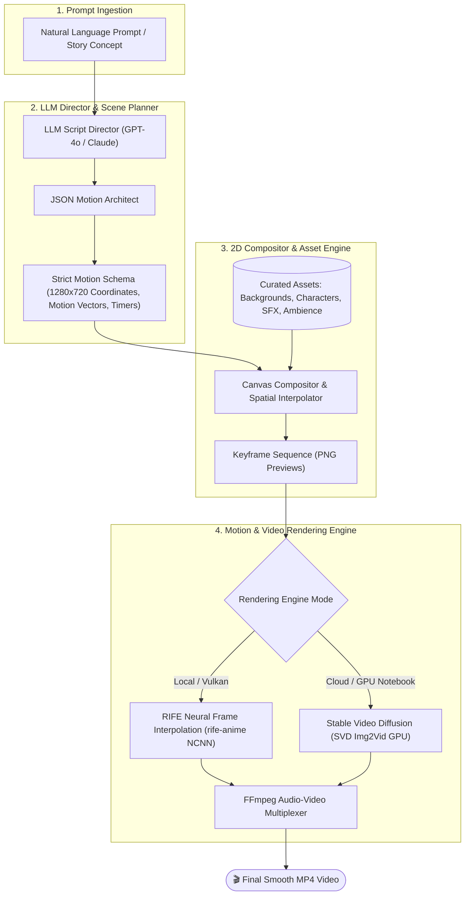

<div align="center">

# 🎬 Snap-Scene: Autonomous AI Story-to-Video Engine

**Transform natural language prompts into multi-scene animated videos using LLM scene orchestration, 2D vector motion synthesis, and RIFE neural frame interpolation / Stable Video Diffusion.**

[](https://www.python.org/)
[](https://stability.ai/)
[](https://github.com/nihui/rife-ncnn-vulkan)
[](https://opencv.org/)
[](https://ffmpeg.org/)
[](https://github.com/astral-sh/uv)
[](LICENSE)
[](https://github.com/husain-saifee/Snap-Scene)

[Overview](#overview) • [Architecture](#architecture) • [Key Features](#key-features) • [Comparison](#generation-pipeline-evolution) • [Quickstart](#quickstart) • [Tech Stack](#tech-stack) • [FAQ](#frequently-asked-questions) • [Author](#author)

---

</div>

## Overview

**Snap-Scene** is an open-source generative AI framework engineered to automate the end-to-end production of animated videos from raw textual concepts. Traditional AI video generation relies heavily on expensive cloud APIs that generate erratic, disconnected clips with poor temporal control. Snap-Scene introduces an intelligent, modular pipeline that bridges high-level story understanding, deterministic 2D spatial motion vectors, and deep neural optical flow interpolation.

Whether you need rapid prototyping for children's stories, animated social content, or a fully automated generative video pipeline, Snap-Scene provides both:
1. **Lightweight Local Execution**: Runs locally on consumer hardware using structured 2D coordinate interpolation and Vulkan-accelerated RIFE.
2. **High-Fidelity Neural Diffusion**: An optional GPU-accelerated pipeline powered by Stability AI's **Stable Video Diffusion (SVD)** and ByteDance Seedance Image-to-Video models.

---

## Architecture

Snap-Scene decouples creative direction, spatial planning, and frame synthesis into distinct, deterministic layers:



---

## Key Features

- 🧠 **Autonomous Story Direction**: Generates visually cohesive 4-to-6 scene episodic story scripts from one-line user concepts.
- 📐 **Vector-Based 2D Motion Planning**: Formats character and object movements into coordinate-bounded motion paths (`walk`, `jump`, `idle`) across a standardized 1280×720 canvas.
- 🎞️ **Neural Frame Interpolation (RIFE)**: Deploys the `rife-anime` Vulkan-accelerated deep optical flow model to interpolate between scene keyframes, turning static compositions into fluid 60 FPS transitions.
- 🌌 **Stable Video Diffusion (SVD) Extension**: Ready-to-run Google Colab GPU notebook integrating Stability AI's `stable-video-diffusion-img2vid` for photorealistic AI video synthesis.
- 🔊 **Integrated Audio Layer**: Pairs scenes with contextual ambient soundtracks (forest, night, rain, beach) and dynamic sound effect triggers (whoosh, jump, meow, click).
- ⚡ **Zero Cloud Cost Option**: The core 2D compositor and RIFE interpolation pipeline run 100% locally without incurring GPU cloud fees.
- 🧪 **Test-Driven Architecture**: Fully covered by `unittest` / `pytest` suites validating JSON schema integrity, asset consistency, and execution pipelines.

---

## Generation Pipeline Evolution

| Dimension | V1: Dataset Stitching (Legacy) | V2: Snap-Scene Motion Engine (Current) | V3: Stable Video Diffusion (Neural) |
|---|---|---|---|
| **Approach** | Keyword search on static dataset | LLM scene planner + 2D vector animation + RIFE | Latent diffusion image-to-video generation |
| **Motion Quality** | Choppy, slideshow feel | Fluid, coherent, continuous trajectory | Cinematic camera movement and morphing |
| **Temporal Consistency** | ❌ None | ✅ High (spatial coordinate tracking) | ✅ High (deep optical latent flow) |
| **Hardware Requirement** | CPU only | Consumer CPU / Vulkan GPU | Dedicated GPU (16GB+ VRAM or Colab T4) |
| **Generation Speed** | Instant (< 2 sec) | Fast (~10–30 sec) | Moderate (~60–90 sec) |
| **Cloud Dependency** | None | None (after LLM planning) | Optional Colab / API |

---

## Tech Stack

| Layer | Technology | Purpose |
|---|---|---|
| **Language** | Python 3.11+ | Core engine and automation scripting |
| **LLM Director** | OpenAI GPT-4o-mini / LangChain-compatible | Story generation and scene choreography |
| **Motion Planning** | Custom JSON Motion Schema | Bounding box coordinates, start/end vectors |
| **Frame Interpolation** | RIFE (rife-ncnn-vulkan) | Neural intermediate flow estimation for smooth animation |
| **Generative Video** | Stable Video Diffusion (SVD) / Seedance | Image-to-video neural generation |
| **Media Assembly** | FFmpeg & OpenCV | Frame compilation, audio mixing, H.264 MP4 export |
| **Packaging & CI** | uv / pip / pytest | High-speed dependency management and automated testing |

---

## Project Structure

```text
Snap-Scene/
├── backend/
│   ├── assets/                      # Curated media library
│   │   ├── audio/                   # Sound effects (jump, whoosh, click, animals)
│   │   ├── backgrounds/             # HD scenic environments (park, beach, forest)
│   │   └── characters/              # Transparent PNG character sprite sheets
│   ├── rife/                        # RIFE NCNN Vulkan binary & models
│   ├── services/                    # Canvas compositor and scene rendering logic
│   ├── static/
│   │   ├── previews/                # Generated scene keyframe previews
│   │   ├── rife_frames/             # Interpolated high-framerate sequence
│   │   └── videos/                  # Final exported MP4 animations
│   ├── tests/                       # Automated pytest / unittest test suite
│   └── workers/
│       ├── story_generator.py       # LLM story scripting module
│       ├── prompt_maker_json.py     # Motion trajectory & scene JSON architect
│       ├── frame_generator.py       # Cloud I2V client (ByteDance Seedance)
│       └── video_worker.py          # RIFE interpolation and FFmpeg assembly
├── colab (optional)/
│   └── snap_scene_svd_pipeline.ipynb # Stable Video Diffusion GPU notebook
├── shared/
│   ├── prompts/                     # System prompts for story & director agents
│   └── schemas/                     # JSON schema for animation specifications
├── .env.example                     # Environment variable blueprint
├── main.py                          # CLI orchestrator entry point
├── pyproject.toml                   # Project metadata and dependencies
├── pytest.ini                       # Test configuration
└── requirements.txt                 # Pinned dependencies
```

---

## Quickstart

### 1. Prerequisites

- **Python 3.11+** installed
- **FFmpeg** installed and accessible via system `PATH` (or specified via `FFMPEG_PATH`)
- (Optional) **Vulkan-compatible GPU** for accelerated RIFE frame interpolation

### 2. Installation

Clone the repository and navigate into the project directory:

```bash
git clone https://github.com/husain-saifee/Snap-Scene.git
cd Snap-Scene
```

Install dependencies using [uv](https://github.com/astral-sh/uv) (recommended) or standard `pip`:

```bash
# Using uv (fastest)
uv sync

# Or using pip
pip install -r requirements.txt
```

### 3. Configuration

Copy the template environment file and add your API credentials:

```bash
cp .env.example .env
```

Edit `.env`:
```ini
# Required for story generation and scene motion planning
OPENAI_API_KEY=your_openai_api_key_here

# Optional: Custom path to FFmpeg binary if not in system PATH
FFMPEG_PATH=ffmpeg
```

### 4. Running the Pipeline

#### Step A: Generate the Story Script
Run the interactive orchestrator:
```bash
python main.py
```
Enter a prompt (e.g., `"A clever fox solves a mystery in an ancient castle"`), and Snap-Scene will generate a structured multi-scene script.

#### Step B: Choreograph Scene Motion
Translate the story into animated vector coordinates:
```bash
python -m backend.workers.prompt_maker_json
```
This produces `backend/workers/image_gen.json` containing spatial trajectories and timing.

#### Step C: Interpolate and Render Video
Synthesize smooth frames and compile the final MP4 video:
```bash
python -m backend.workers.video_worker
```
The output video will be exported to `backend/static/videos/output.mp4`.

#### Step D: Run Stable Video Diffusion (Optional GPU Mode)
For photorealistic neural video generation:
1. Open [`colab (optional)/snap_scene_svd_pipeline.ipynb`](colab%20(optional)/snap_scene_svd_pipeline.ipynb) in **Google Colab**.
2. Select a GPU runtime (T4 or higher).
3. Upload your rendered keyframes to generate deep latent neural video.

### 5. Running Tests

Verify your environment and schema integrity:

```bash
# Using unittest
python -m unittest discover -s backend/tests

# Or using pytest
pytest
```

---

## Frequently Asked Questions

<details>
<summary><b>Can I run Snap-Scene completely offline without GPU?</b></summary>
Yes! The core 2D animation compositor, motion vector engine, and FFmpeg assembler run smoothly on any modern CPU. The included RIFE executable can also execute in CPU mode (<code>-g -1</code>) or leverage Vulkan-compatible integrated graphics.
</details>

<details>
<summary><b>How does Snap-Scene eliminate the slideshow stutter?</b></summary>
Unlike basic frame-stitching tools, Snap-Scene calculates linear coordinate vectors between start and end positions, then feeds the scene keyframes through <b>RIFE (Real-Time Intermediate Flow Estimation)</b> to synthesize intermediate frames using deep optical flow, producing natural, continuous movement.
</details>

<details>
<summary><b>How do I add custom characters or backgrounds?</b></summary>
Simply drop transparent PNG sprites into <code>backend/assets/characters/</code> and 1280×720 backgrounds into <code>backend/assets/backgrounds/</code>. The LLM director automatically references available assets via <code>backend/assets_structure.md</code>.
</details>

<details>
<summary><b>How does Snap-Scene compare to commercial platforms like Runway or Pika?</b></summary>
Commercial tools are black-box cloud APIs that require subscription fees and often generate unpredictable camera shifts. Snap-Scene provides deterministic spatial control over specific characters and objects, open-source code ownership, and zero operational costs for local workflows.
</details>

---

## Contributing

Contributions, feedback, and suggestions are welcome!
1. Fork the Project
2. Create your Feature Branch (`git checkout -b feature/AmazingFeature`)
3. Commit your Changes (`git commit -m 'feat: add amazing feature'`)
4. Push to the Branch (`git push origin feature/AmazingFeature`)
5. Open a Pull Request

---

## Author

**Husain Saifee**
- GitHub: [@husain-saifee](https://github.com/husain-saifee)
- Repository: [Snap-Scene](https://github.com/husain-saifee/Snap-Scene)

---

## License

This project is licensed under the MIT License — see the [LICENSE](LICENSE) file for details.
